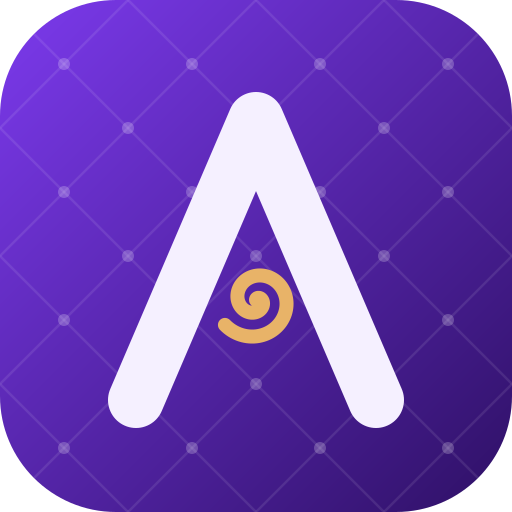

> [!IMPORTANT]
> Remove this line to confirm you've reviewed this PR before submitting.

<p align="center">
  
</p>

<h1 align="center">Asylum</h1>

<p align="center">
  A free and open-source code editor for mobile and full-stack development,<br>
  built on top of <a href="https://github.com/zed-industries/zed">Zed</a>.
</p>

<p align="center">
  <a href="https://github.com/viniengelage/asylum/releases/latest">Download</a> ·
  <a href="#building-from-source">Build from source</a> ·
  <a href="NOTICE">Notice</a> ·
  <a href="LICENSE-GPL">License</a>
</p>

---

Asylum keeps everything that makes Zed fast (the GPU-rendered UI, tree-sitter, language servers,
multi-buffers, Vim mode) and adds the tools a mobile and web developer usually keeps in other
windows: device emulators, a browser, an API client, a database client and an agent that can
drive all of them. It is free, has no account, no subscription and no hosted services of its own.

> [!NOTE]
> Asylum is an independent fork. It is **not** affiliated with or endorsed by Zed Industries.
> See [NOTICE](NOTICE) for attribution and licensing details.

## Features

**Devices**
- **iOS Simulator embedded in the editor** (macOS), with touch, keyboard, rotation and a manager
  to download runtimes and create simulators.
- **Android emulator embedded in the editor**: Asylum downloads the JDK, the SDK and the system
  images on demand and creates the virtual devices for you.
- React Native / Expo debug adapter.

**Web**
- **Web Preview**: a Chromium tab inside the workspace (CEF), with DevTools protocol access so the
  agent can open, inspect and interact with pages.

**Backend tools**
- **API client** compatible with Postman collections and OpenAPI: environments, captures, cookies,
  forms and code lenses that send requests straight from your spec.
- **Database client** for PostgreSQL: query editor, result grid and schema browser.
- **Docker dock**: containers, logs and actions without leaving the editor.
- **Elasticsearch dock**: ES|QL queries, live tail and trace view.

**Asylum Agent**
- Zed's native agent, reworked to spend fewer tokens (compact tool output, smarter context).
- Tools to drive the docks: devices, browser, database, API client.
- **Task agents** (`/command`), **pipelines** with per-step acceptance criteria, **plan mode**,
  profiles and per-profile toolkits.
- Bring your own model: Anthropic (including a Claude subscription), OpenAI, Google, Ollama and the
  other providers supported upstream, plus any ACP agent such as Claude Code or Codex.

**Workflow**
- GitHub repositories, pull requests and Projects boards; ClickUp tasks.
- **Settings sync** through your GitHub account: settings, keymap, snippets, themes, agents and
  flows are kept in a private gist, with no Asylum server involved.
- Profiles with their own data directory, icon and launcher.
- A unified pane layout tuned for ultrawide monitors, and Asylum's own icon family.

## Install

Download the latest build from the
[releases page](https://github.com/viniengelage/asylum/releases/latest) or the
[project page](https://viniengelage.github.io/asylum/).

| Platform | Status |
|---|---|
| macOS (Apple Silicon) | Supported |
| Windows (x86_64) | Preview: the Android emulator works; the iOS Simulator and Web Preview are macOS-only |
| Linux | Builds from source; no packaged release yet |

Builds are not notarized yet. On macOS, the first time you open Asylum right-click the app and
choose **Open**.

Asylum uses its own data directories (`~/Library/Application Support/Asylum` and
`~/.config/asylum` on macOS), so it can be installed next to Zed without sharing settings.

## Building from source

Requirements:

- Rust (the toolchain in `rust-toolchain.toml` is installed automatically by `rustup`).
- macOS: Xcode with the Metal Toolchain (`xcodebuild -downloadComponent MetalToolchain` on
  Xcode 26+), and [Ninja](https://ninja-build.org/) for the Web Preview (`brew install ninja`).
- Windows and Linux: see Zed's guides for
  [Windows](docs/src/development/windows.md) and [Linux](docs/src/development/linux.md);
  the same dependencies apply.

```sh
git clone https://github.com/viniengelage/asylum.git
cd asylum
cargo run --release
```

To produce a macOS app bundle and DMG, run `script/bundle-mac`.

## Contributing

Issues and pull requests are welcome. Before opening a pull request, run `./script/clippy` and the
tests of the crates you touched. See [CONTRIBUTING.md](CONTRIBUTING.md).

## License

Asylum is distributed under the same licenses as Zed: **GPL-3.0-or-later** for most of the source
tree ([LICENSE-GPL](LICENSE-GPL)) and **Apache-2.0** for the components marked as such, such as
GPUI ([LICENSE-APACHE](LICENSE-APACHE)). Every crate declares its license in its `Cargo.toml`.

Asylum is a modified version of [Zed](https://github.com/zed-industries/zed), © Zed Industries,
Inc. "Zed" is a trademark of Zed Industries, Inc., used here only to describe where the code comes
from. The changes Asylum makes are listed in [NOTICE](NOTICE) and in the git history.

Third-party dependency licenses are collected with
[`cargo-about`](https://github.com/EmbarkStudios/cargo-about) and can be viewed in the app under
**Help → View Dependency Licenses**. If CI reports a missing license, see
`script/licenses/zed-licenses.toml`.
